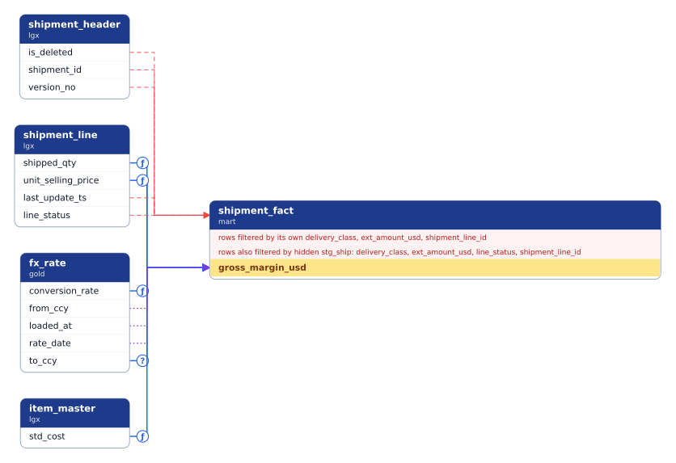
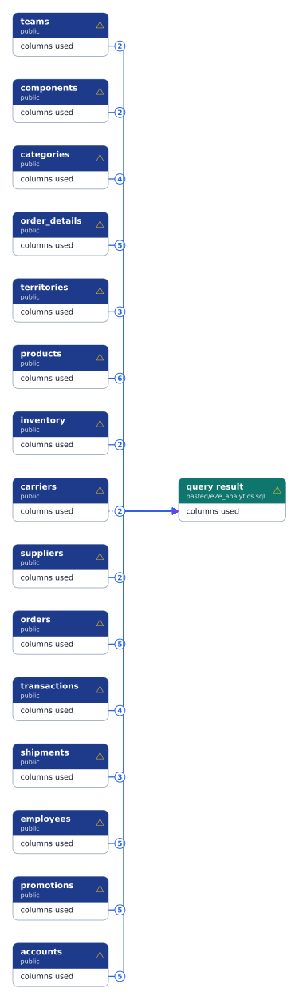
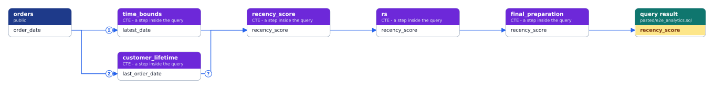
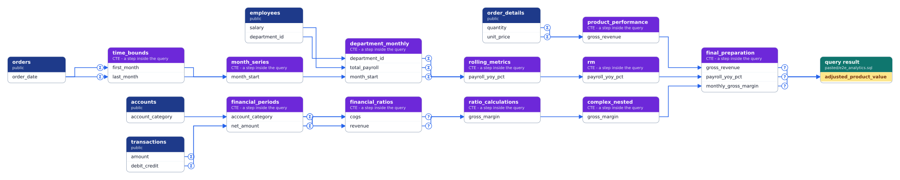

# Lineage explorer: before and after

The Lineage graph view, redrawn for readability (MVP plan F2.1). The same graph and the same
questions, drawn by the old renderer (Graphviz) and the new one (ELK).

**What changed:**
- **Straight lines only:** horizontal and vertical segments, with no curves.
- **Fewer crossings:** edges into one column share a trunk, and the rows inside each card are reordered so lines do not cross.
- **One card per table,** with a row per column. A table no longer appears twice (a cluster plus a red cylinder for its filters).
- **Each fact is drawn once.** Two statements writing the same column now draw one line, not two.
- **Badges instead of text:** `Σ` aggregated, `ƒ` derived, `?` conditional; no badge means copied. They replace the word on every line.
- **Filters are shown, not walked:** a filter is drawn where it acts, but its own sources are not followed, which removes unrelated tables. A checkbox brings them back.
- **Self-filters become a header line,** "rows filtered by its own …", instead of loops.
- **⚠ on a card** marks a gap (a boundary or refused statement); hover it for the reason.

## 1. Where does `mart.shipment_fact.gross_margin_usd` come from? (2 hops up)

| Before | After |
|---|---|
|  |  |

### 1b. The same, with temp tables hidden (F2.2, the default)

The temp table `pg_temp.stg_ship` is hidden. Every line through it is joined into one line, keeping the hardest transform; hover a line to see what it passed through. Filters that came from the hidden table's own columns are stated on the card, not dropped.

**Joining rules.** The hardest transform wins, as in the parser (D-7). The last row is a display choice: the hidden table's rows decide the rows of what is built from it.

| Path through the hidden table | Joined line |
|---|---|
| value, then value | value, with the hardest transform (identity < derived < conditional < aggregated) |
| value then influence, or influence then anything | influence |
| anything, then a filter | filter on the final table |
| a filter into the hidden table, then anything | filter on the table built from it (its rows decide those rows) |

## 2. What does `s2p.po_distribution.amount_cancelled` affect? (2 hops down)

| Before | After |
|---|---|
|  |  |

## 3. What decides `last_touch_ts` in the pasted M5 query? (1 hop up)

| Before | After |
|---|---|
|  |  |

## How to read the new diagram

| Mark | Meaning |
|---|---|
| Solid blue line | **value**: data flows into the column |
| `Σ` / `ƒ` / `?` badge | aggregated / derived / conditional |
| Dashed red line into a card's header | **filter**: decides which rows of that table exist |
| Dotted purple line | **influence**: grouping or window ordering |
| Yellow row | the column you asked about |
| Teal header | a query's result (a SELECT with no target table) |
| Grey header | a temp table |
| ⚠ | a gap on that table; hover for the reason |

## 4. A whole file at table level (gap 9)

A 900-line analytics query: 49 result columns fed by 15 tables. In column detail that's 268 lines into one 49-row card. **Detail: Tables**, the default above 120 edges, shows one line per pair of tables. Each line's badge is the number of the source table's columns behind it, and hovering breaks that number down into values, grouping and filters.

## 5. Stepping through the query's CTEs (gap 8)

In the normal view, a single `SELECT` is always one hop: base column to result column. **Step through the query (CTEs)** walks one result column back through each CTE and subquery. Purple cards are the steps.

`recency_score`: `orders` → `customer_lifetime` / `time_bounds` → `recency_score` → `final_preparation` → result.

`adjusted_product_value`: three branches (payroll, revenue and financial margin) through 10 steps.

This is a reading aid. It follows how the **value** is computed, using SQLGlot's column lineage. Filters and grouping stay in the normal view, and the lineage facts, Ask and the impact report always come from the parser.
