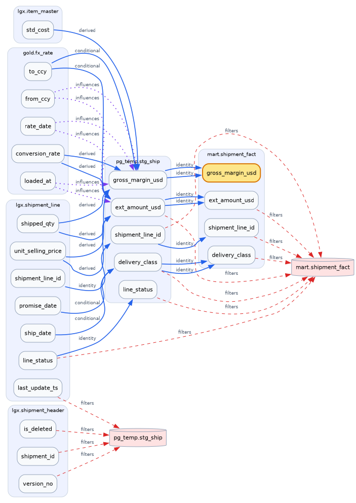
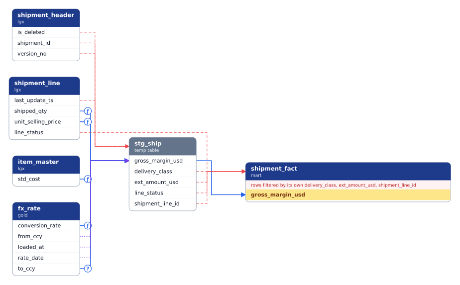
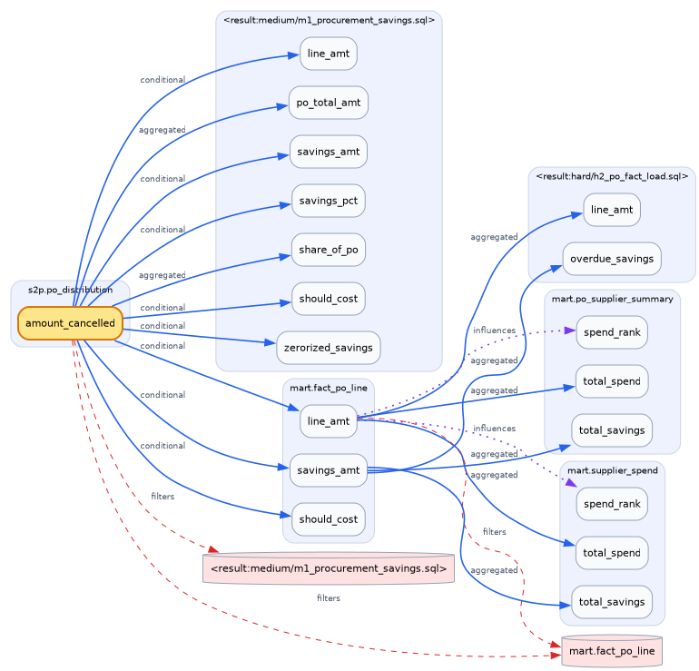
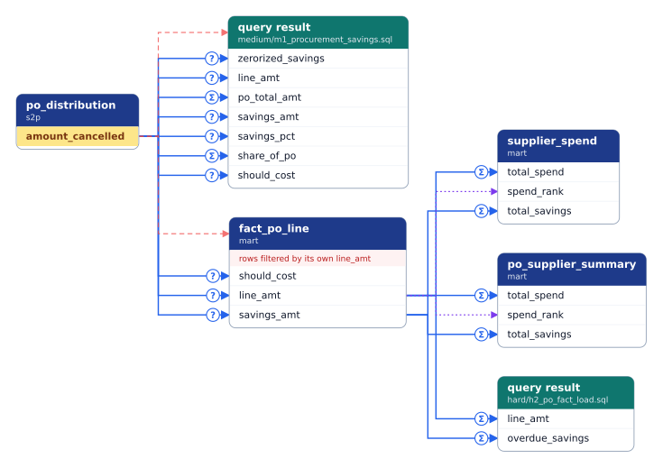
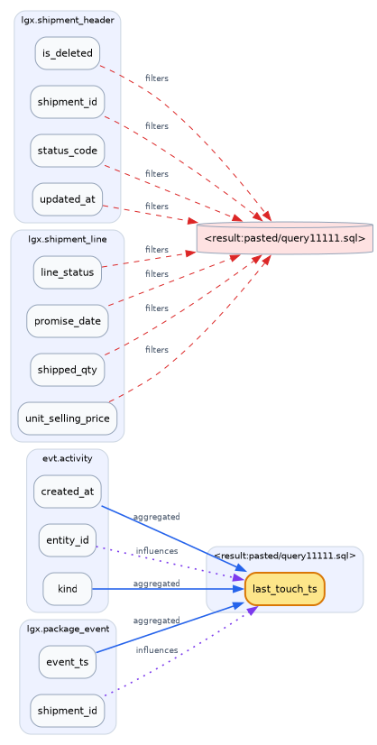
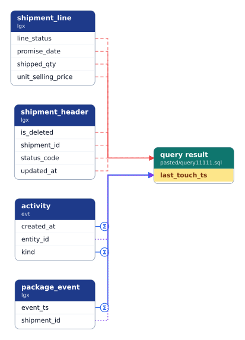

# Lineage explorer: before and after

The Lineage graph view, redrawn for readability (MVP plan F2.1). The same graph and the same
questions, drawn by the old renderer (Graphviz) and the new one (ELK).

**What changed:**
- **Straight lines only:** horizontal and vertical segments, with no curves.
- **Fewer crossings:** edges into one column share a trunk, and the rows inside each card are reordered so lines do not cross.
- **One card per table,** with a row per column. A table no longer appears twice (a cluster plus a red cylinder for its filters).
- **Each fact is drawn once.** Two statements writing the same column now draw one line, not two.
- **Badges instead of text:** `Σ` aggregated, `ƒ` derived, `?` conditional; no badge means copied. They replace the word on every line.
- **Filters are shown, not walked:** a filter is drawn where it acts, but its own sources are not followed, which removes unrelated tables. A checkbox brings them back.
- **Self-filters become a header line,** "rows filtered by its own …", instead of loops.
- **⚠ on a card** marks a gap (a boundary or refused statement); hover it for the reason.

## 1. Where does `mart.shipment_fact.gross_margin_usd` come from? (2 hops up)

| Before | After |
|---|---|
|  |  |

## 2. What does `s2p.po_distribution.amount_cancelled` affect? (2 hops down)

| Before | After |
|---|---|
|  |  |

## 3. What decides `last_touch_ts` in the pasted M5 query? (1 hop up)

| Before | After |
|---|---|
|  |  |

## How to read the new diagram

| Mark | Meaning |
|---|---|
| Solid blue line | **value**: data flows into the column |
| `Σ` / `ƒ` / `?` badge | aggregated / derived / conditional |
| Dashed red line into a card's header | **filter**: decides which rows of that table exist |
| Dotted purple line | **influence**: grouping or window ordering |
| Yellow row | the column you asked about |
| Teal header | a query's result (a SELECT with no target table) |
| Grey header | a temp table |
| ⚠ | a gap on that table; hover for the reason |
