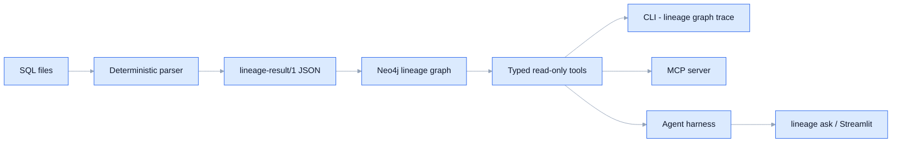

# Lineage knowledge graph and agentic Q&A

The deterministic parser's output, loaded into Neo4j, queried through typed tools, and
answered in plain English by a Claude agent inside a harness. PostgreSQL only for now.



## 1. Set up

1. Install the core pins and the knowledge-graph pins:
   ```
   .venv\Scripts\python.exe -m pip install --require-hashes -r requirements.txt
   .venv\Scripts\python.exe -m pip install --require-hashes -r requirements-kg.txt -c requirements.txt
   ```
2. Start Neo4j (Docker Desktop must be running). Its browser UI is at http://localhost:7474, with user `neo4j` and password `lineage_graph`.
   ```
   docker compose up -d neo4j
   ```
3. Build the graph from a folder of SQL files:
   ```
   .venv\Scripts\lineage graph build stress/pg/final --dictionary stress/pg/final/dictionary.json
   ```
4. Claude calls use your Claude Code login (Claude Agent SDK); no API key is needed in development.

Connection settings come from `NEO4J_URI`, `NEO4J_USER`, `NEO4J_PASSWORD` and `NEO4J_DATABASE`.

**Schema without a hand-written dictionary (MVP M2):**
```
docker compose up -d postgres
.venv\Scripts\python.exe scripts\pg_seed.py          # loads both suites' DDL: lineage_batch, lineage_final
.venv\Scripts\lineage schema pull --database lineage_final --out final.json
.venv\Scripts\python.exe scripts\pg_exec_suite.py    # runs the medium and hard SQL in PostgreSQL, rolled back
```
- PostgreSQL settings come from `PG_HOST`, `PG_PORT`, `PG_USER`, `PG_PASSWORD` and `PG_DATABASE`.
- A pulled dictionary is identical (same fingerprint) to the one built from the same DDL.

## 2. Commands

| Command | What it does |
|---|---|
| `lineage analyse FILE --dialect postgres --output out.json` | parse one file; write the whole result (`lineage-result/1`) |
| `lineage graph build FOLDER --dictionary D` | analyse a folder and load Neo4j (`--keep` merges instead of replacing) |
| `lineage schema pull --database DB --out D` | read the dictionary from a live PostgreSQL (read-only; schemas and default schema come from the database) |
| `lineage schema from-ddl FILE --out D` | build the dictionary from `CREATE TABLE` statements |
| `lineage graph trace COLUMN [--depth N] [--down]` | upstream lineage or downstream impact, from the graph |
| `lineage graph impact NODE [--change drop\|rename\|type] [--format md\|csv\|json] [--out F]` | impact report: affected columns, statements and lines to edit, unknowns (no LLM) |
| `lineage ask "QUESTION" [--no-cache]` | answer a question through the agent harness; prints the trace path |
| `lineage replay TRACE.json` | re-run a trace's tool calls against the current graph; report differences |
| `lineage eval --run DIR [--questions Q.yaml]` | ask every golden question, save answers and traces, score |
| `lineage eval --answers A.json` | score saved answers (no model calls) |

## 3. The graph

- **Nodes:** `Table`, `Column`, `Variable`, `File`, `Statement`, `Boundary`, `Refusal`.
- **Lineage relationships:** `FEEDS` (value), `FILTERS` (filter, ending at a table) and `INFLUENCES` (influence). There is one per parser edge, carrying its transform, phase, band, tier and file:line.
- **Structural relationships:** `HAS_COLUMN`, `CONTAINS`, `READS` / `WRITES`, `DECLARES`, `BLOCKED_BY`, `BOUNDS`, `REFUSED` and `MENTIONS`.
- How to read all of it is in [the semantics document](../src/lineage/semantics/lineage_semantics.md), which is the text the LLM reads.

## 4. Tools (read-only)

- The tools are `find`, `upstream`, `downstream`, `path`, `explain_edge`, `gaps` and `coverage`.
- `graph_query` is a model-written Cypher fallback. It is rejected unless it is read-only, uses only known schema and passes `EXPLAIN`; it also gets a row limit.
- Every query runs in a READ-mode session, so Neo4j itself refuses writes.

## 5. MCP server

`.mcp.json` registers it for Claude Code. To start it by hand:

```
.venv\Scripts\python.exe -m lineage.mcp.server
```

It exposes the eight typed tools (including `impact`), the resource `lineage://semantics` and the prompt `lineage_semantics`.

## 6. The harness (`lineage ask`)

1. **Write guard:** a request to change data or the graph is refused. This step is deterministic.
2. **Name resolver:** an ambiguous bare name, e.g. `customer_id`, gets a clarifying question. Also deterministic.
3. **Agent loop:** Claude (`claude-sonnet-5-5`, effort `medium`) with only the graph tools. The Claude Code built-in tools are off, no settings are loaded, and the answer comes back as structured JSON citing graph ids.
4. **Grounding check:** every cited id must come from a tool result in this run. If not, it retries once, then drops the invented id.
5. **Coverage gate:** boundaries on the cited statements are added as unknowns.
6. **Cache and trace:**
   - The cache key covers the question, graph snapshot, model, effort and prompt fingerprint.
   - Traces go in `.lineage_cache/`.
   - `eval --run` never reads the cache.

## 7. Evaluation

- **Golden set** (`evals/golden_questions.yaml`): 30 questions whose expected answers are read from the graph, which C3 proved matches the answer keys.
- **Business set** (`evals/business_questions.yaml`): 5 multi-hop questions.
- **Scoring is by citations, not wording** (Option A):
  - when the answer is a set of edges, those edges must match exactly;
  - when the answer is a list of nodes or unknowns, the list must match exactly, and cited edges are evidence that must be real and on the asked lineage.

| Run | Model | Score | Cost |
|---|---|---|---|
| baseline | Opus 5.5 | 20/30 (19/30 under the strict scorer) | $1.26 |
| v2 | Sonnet 5.5, medium | **30/30** golden, **5/5** business | $0.60 + $0.28 |
| harness 1 | Sonnet 5.5, medium | M5 set 8/10, hard set 8/10 | |
| harness 2 | Sonnet 5.5, medium | **30/30** golden, **5/5** business, **10/10** M5, **10/10** hard | |

- **M5 set** (`evals/m5_questions.yaml`) and **hard set** (`evals/hard_questions.yaml`): questions on M5, loaded as `pasted/query11111.sql`. The hard set mixes multi-hop paths, filters and aggregation.
- **Harness 2 changes:**
  - `explain_edge` shows the whole statement, up to 200 lines (it used to stop at 25);
  - `coverage` says its lineage counts are incoming only;
  - the prompt adds rules for one-hop scope, D-47 influences, list answers and refusals that come back twice;
  - the semantics document says outer-join and scalar-subquery predicates are `conditional` values.

## 8. Streamlit (temporary observability UI)

```
.venv\Scripts\python.exe -m streamlit run frontend/app.py
```

The sidebar's **View** offers three views:
- **Parse SQL:** the original analyser view. *Schema* in the sidebar: bundled test dictionary, **live PostgreSQL** (Pull schema), **upload DDL**, or infer from the SQL. To ask about SQL you paste, analyse it, then open **Load this SQL into the lineage graph** and press **Load into graph**. *Replace* makes the graph hold only this SQL; *add* merges it beside what is there. Then switch the view.
- **Ask the lineage:** answer, status, evidence graph and table, unknowns, and the full trace. It uses the cache unless you untick it.
- **Lineage graph:** a column's upstream lineage or downstream impact, by hops and flows, grouped by table, with the gaps on that lineage.
- **Impact report:** what breaks if a column or table is dropped, renamed or retyped; downloads as Markdown or CSV.

## 9. Five tasks to try (the C9 gate)

1. **Trace a column:** where does `mart.shipment_fact.gross_margin_usd` come from, two hops up? Use `lineage graph trace`, or the Lineage graph view.
2. **Impact of a change:** what breaks if `s2p.po_distribution.amount_cancelled` is dropped? Use downstream in the Lineage graph view, or `lineage ask`.
3. **Find the gaps:** what could not be analysed in `hard/h4_nightly_load.sql`?
4. **Open question:** "Which tables are filtered by a column named status_code?"
5. **Rejected request:** "Delete all lineage for mart.fact_po_line." It must be refused.

## 10. Known limits

- **PostgreSQL only.** Other dialects come after the PostgreSQL flow is complete.
- **A refused statement has no edges.** It is tied to its file, and through `MENTIONS` to the tables its SQL names, never to a column.
- **The Neo4j tests replace the graph.** Rebuild it afterwards, and `lineage eval --run` refuses to start on a graph that is missing golden nodes.
- **Usage counts against the Claude Code plan in development.** Switch to an API key for production.
