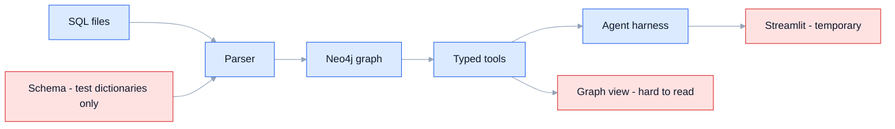
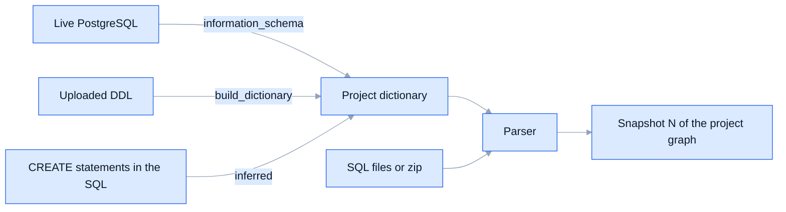
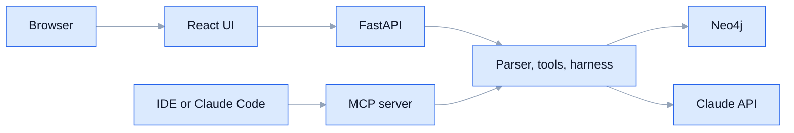
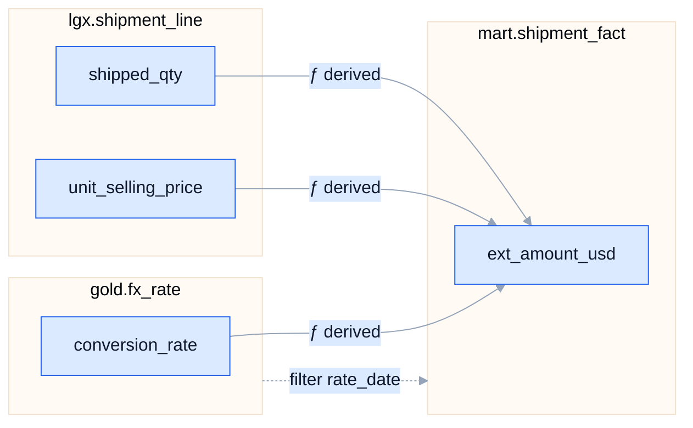
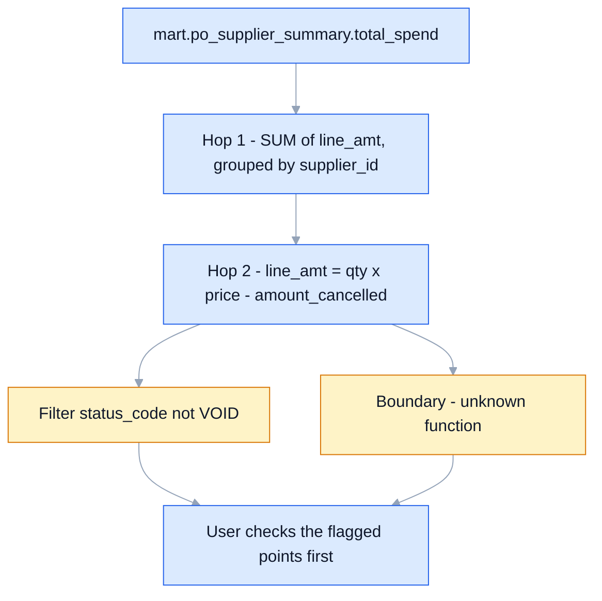
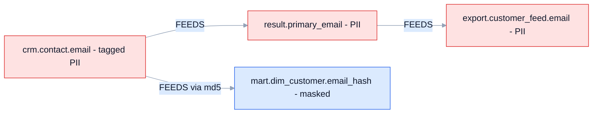
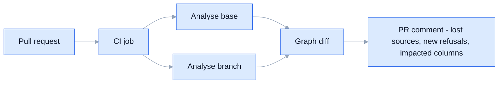

# Lineage MVP: plan and feature options

*2026-10-09. PostgreSQL only. Concise pointers; details on request.* 

## 1. Where we are

- **Parser:** turns SQL into edges, boundaries and refusals.
- **Graph:** Neo4j, versioned snapshots.
- **Typed tools:** read-only.
- **Agent harness:** grounded and cached. Golden 30/30, business 5/5, M5 10/10, hard 10/10.
- **Interfaces:** CLI, MCP, Streamlit (temporary).
- **Gaps:**
  - no readable lineage view;
  - the schema comes from our own test dictionaries;
  - no packaging;
  - no users or projects;
  - the LLM runs on a dev login.

## 2. Who it is for, and the job each does

| User | Job | Feature that serves it |
|---|---|---|
| Data engineer | "What breaks if I change this column?" | F3 Impact report, F7 PR lineage diff |
| Analyst | "Where does this number come from? It looks wrong." | F2 Lineage explorer, F4 Root-cause walk |
| New joiner | "Explain this 2,000-line SQL codebase." | F5 Auto column docs, Ask |
| Governance | "Where does PII end up?" | F6 Sensitive-data propagation |
| Platform owner | "What can we delete?" | F8 Dead column finder |

## 3. MVP foundation (must have)

### M1. Projects and ingestion
- A project holds SQL files, a schema and a snapshot history.
- **Input options:**
  - upload files or a zip;
  - point at a Git repository (later).
- Re-analyse on change; every run is a new snapshot, and the old one stays queryable.

### M2. Schema input, with no hand-written dictionary
*Status 2026-10-09: done for the CLI and Streamlit. Live pull equals the DDL build for both suites; 10/10 medium and hard files run cleanly in PostgreSQL (m3 fixed with a cast; edges unchanged).*

1. **Pull from a live PostgreSQL** (`information_schema`, read-only user). Easiest for users.
2. **Upload DDL** (`CREATE TABLE` scripts); the dictionary is built with `build_dictionary`.
3. **Infer** from the SQL's own `CREATE` statements; anything missing is shown as a boundary.

### M3. App shell: API plus web UI
- **Backend:** FastAPI wrapping the parser, the graph and the harness, which already exist.
- **Frontend:**
  - React with **React Flow** and **ELK** layout, the standard for lineage UIs (dbt docs, DataHub style);
  - Streamlit cannot do interactive graphs well.
- **Three panes:** Explorer (F2), Ask, and Gaps and coverage.

### M4. Packaging and running
- One `docker compose up` brings up the API, UI and Neo4j.
- `pip install` gives the CLI and MCP server, for engineers in an IDE.
- **LLM:** a Claude API key per deployment, Sonnet 5.5 at effort medium, the answer cache, and a per-project budget cap.
- **Privacy:** the LLM sees SQL code and lineage only, never data rows. Self-hosting keeps the code on-premises.

## 4. High-impact features

### F2. Readable lineage explorer (fixes today's graph)
- **Tables are cards** with their columns as rows; edges run column to column.
- **Focus mode:** pick a column and see N hops up or down; everything else is hidden.
- **Edge styles:**
  - value as a solid line, filter as dashed, influence as dotted;
  - a transform badge (`Σ`, `ƒ`, `?`).
- **Collapse CTEs and temp tables** into their statement; expand on click.
- **Click an edge** to see its SQL with the line highlighted (from `explain_edge`).
- **Gaps are drawn as red markers** on the affected tables.

### F3. Impact report: "what breaks if I change X"
- **Input:** a column or table, and a change (drop, rename or type change).
- **Output:**
  - every downstream column, ranked by hop count and transform;
  - the files and lines to edit;
  - unknowns on the path.
- Export as Markdown or CSV, ready for a ticket.

### F4. Root-cause walk: "this number looks wrong"
- A guided upstream walk: at each hop it shows **what feeds it, what filters it, and what groups it**.
- The agent explains each hop in plain English, citing edges.
- **Flags suspicious points:**
  - a filter that may drop rows;
  - a join or aggregate that can duplicate or merge;
  - an unknown function.

### F5. Auto column documentation
- One sentence per column, generated from its lineage and cited, for example "SUM of `line_amt` per supplier, excluding VOID lines".
- Stored separately from parser facts and labelled **AI (Tier D)**; users can edit or approve it.
- Export as a data dictionary (Markdown or CSV), or push to a catalog later.

### F6. Sensitive-data (PII) propagation
- Tag source columns as `PII`, `financial` and so on, by hand or with name rules (`email`, `ssn`, `phone`).
- **Tags spread along value edges** (not filters) to every column they reach.
- **The report shows:**
  - where PII lands;
  - which tables are tainted;
  - where it is masked (when a known masking function is on the path).
- Deterministic: no LLM needed.

### F7. Lineage diff on pull requests
- CI analyses the base and the branch and compares the two graphs.
- **A PR comment lists:**
  - lost or gained sources;
  - new refusals;
  - downstream columns affected.
- This catches breaking changes **before** merge, and is the strongest daily-workflow hook.

### F8. Dead column and table finder
- Columns that are written but never read downstream, and tables nothing reads.
- **Caveat:** "never read" means never read **in the analysed SQL**. Shown as candidates, not facts.

### F9. Shareable answers and feedback
- Each answer gets a permalink showing its evidence graph and SQL.
- Thumbs up or down; a thumbs-down becomes a new golden question, so the eval set grows from real use.

### F10. Exports and integrations (later)
- OpenLineage JSON, then DataHub, OpenMetadata or Purview.
- dbt projects: compile, then analyse the compiled SQL.

## 5. Priority: impact against effort

| Feature | Impact | Effort | When |
|---|---|---|---|
| M1 to M4 foundation | must have | medium | MVP |
| F2 Explorer | very high | medium | MVP |
| F3 Impact report | very high | low (`downstream` exists) | MVP |
| F4 Root-cause walk | high | low to medium | MVP |
| F6 PII propagation | high | low | MVP+ |
| F7 PR lineage diff | very high | medium | MVP+ |
| F5 Column docs | medium to high | low | MVP+ |
| F8 Dead columns | medium | low | MVP+ |
| F9 Feedback loop | medium | low | MVP+ |
| F10 Integrations | medium | medium to high | later |

## 6. Phases, each with a gate

```mermaid
%%{init: {"theme": "base", "themeVariables": {"primaryColor": "#dbeafe", "primaryTextColor": "#0f172a", "primaryBorderColor": "#2563eb", "lineColor": "#94a3b8", "textColor": "#94a3b8", "edgeLabelBackground": "#dbeafe"}}}%%
flowchart LR
    classDef default fill:#dbeafe,stroke:#2563eb,color:#0f172a
    P1[P1 Foundation - M1 to M4] --> P2[P2 Explorer and Ask UI - F2]
    P2 --> P3[P3 Daily jobs - F3, F4]
    P3 --> P4[P4 Governance - F6, F5, F8]
    P4 --> P5[P5 Workflow - F7, F9]
    P5 --> P6[P6 Integrations - F10]
```

| Phase | Gate |
|---|---|
| P1 | `docker compose up` works on a clean machine; a project is created from a zip plus a live-database schema; all eval sets still pass |
| P2 | a user traces `gross_margin_usd` to its sources in under a minute, without help; the Ask answer highlights its evidence in the explorer |
| P3 | the impact report for `amount_cancelled` matches `downstream` exactly; the root-cause walk flags every filter and boundary on the path |
| P4 | PII tags reach exactly the columns the value edges reach (tested against the keys) |
| P5 | a PR that drops a source column gets a correct comment in CI |

## 7. Decisions needed from you

1. **First user persona:** data engineer (impact and PR diff) or analyst (explorer and root cause)?
2. **UI stack:** React with React Flow (recommended), or keep improving Streamlit for now?
3. **Deployment:** self-hosted Docker (recommended for SQL privacy) or hosted SaaS?
4. **Default schema source:** live PostgreSQL connection (recommended) or DDL upload?
